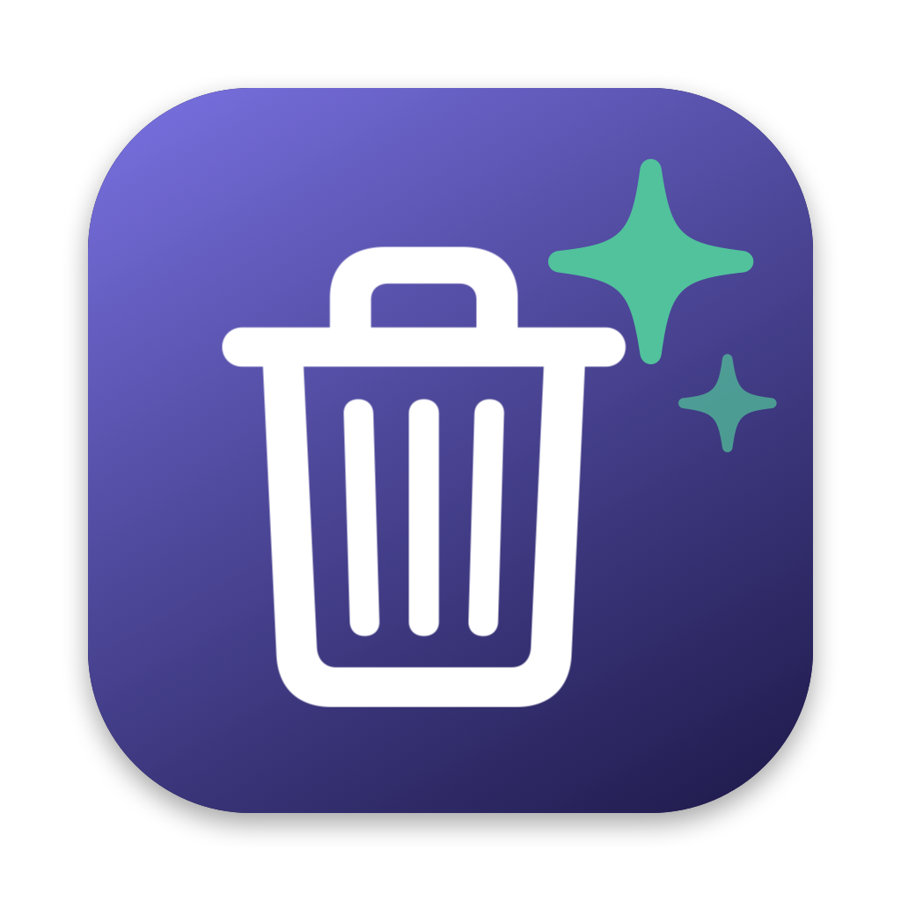
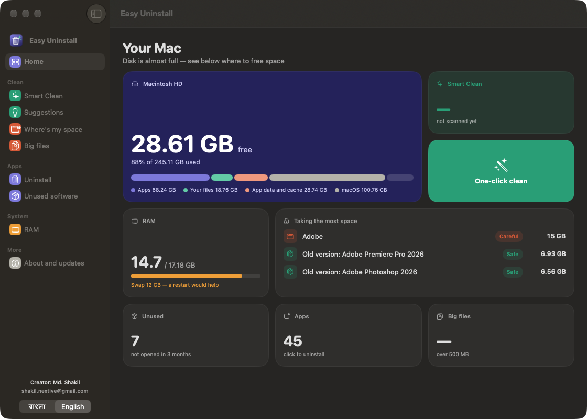
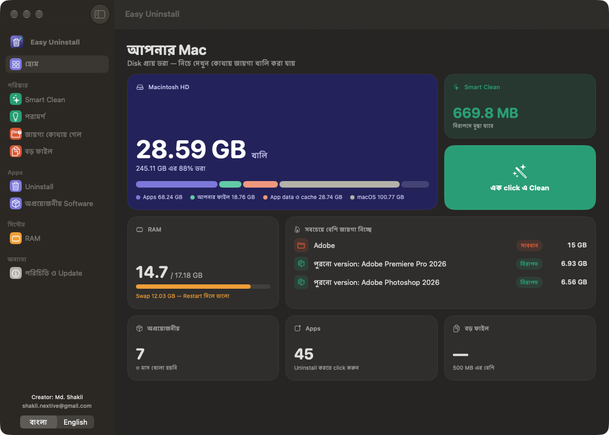
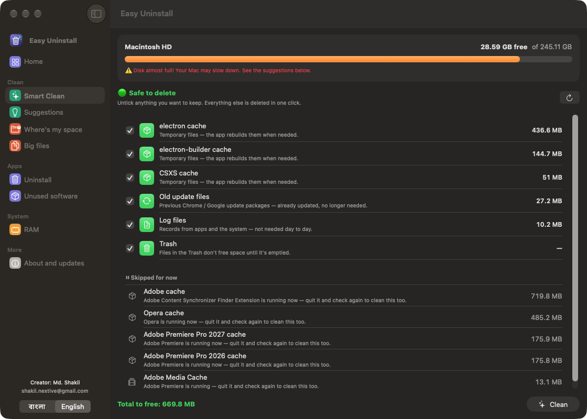
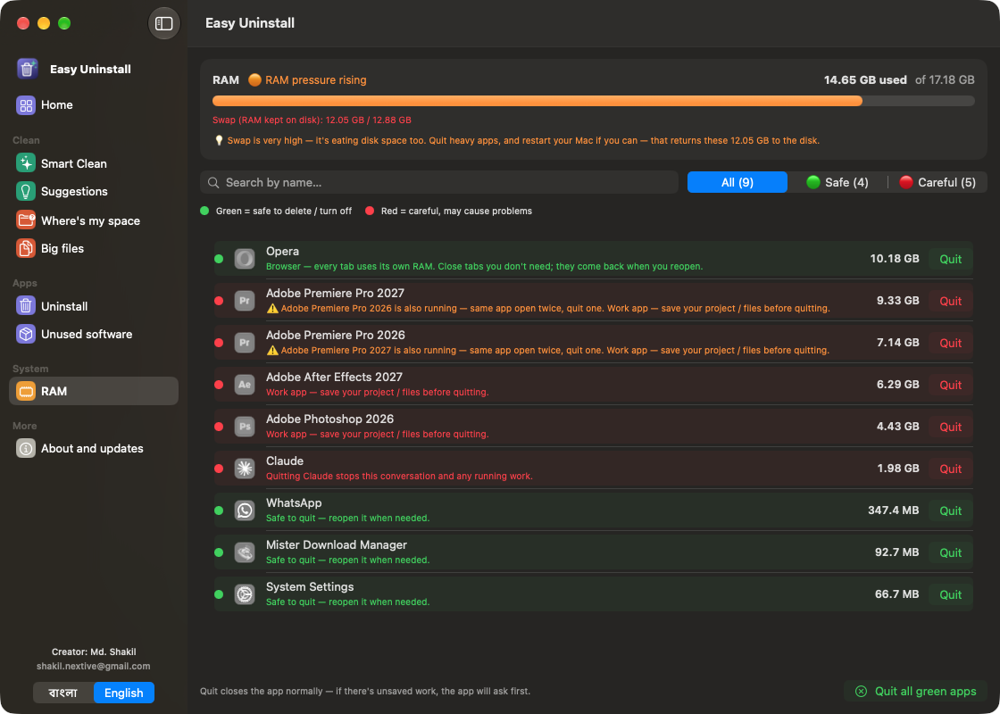
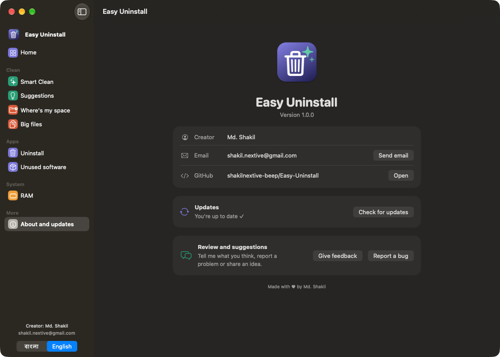

<div align="center">



# Easy Uninstall

**Uninstall apps completely, find out where your disk space went, and free it safely — in one click.**

**Software পুরোপুরি uninstall করুন, disk এর জায়গা কোথায় গেল দেখুন, আর নিরাপদে এক click এ জায়গা খালি করুন।**

[](https://github.com/shakilnextive-beep/Easy-Uninstall/releases/latest)
[](https://github.com/shakilnextive-beep/Easy-Uninstall/releases)


[](LICENSE)

</div>

<p align="center">
  
</p>

---

## ⬇️ Download

| Platform | Download | Status |
| --- | --- | --- |
| 🍎 **macOS** (Apple Silicon + Intel, macOS 13 or later) | [**Download for Mac**](https://github.com/shakilnextive-beep/Easy-Uninstall/releases/latest/download/Easy-Uninstall-mac.zip) | ✅ Available |
| 🪟 **Windows** | Coming soon | 🚧 In progress |

> All versions: [Releases page](https://github.com/shakilnextive-beep/Easy-Uninstall/releases)

### Install on Mac

1. Download **Easy-Uninstall-mac.zip** and double-click it to unzip.
2. Drag **Easy Uninstall.app** into your **Applications** folder.
3. Open it. The first time, macOS may say it *can't verify the developer*, because the app is free and not sold through the App Store:
   - Open **System Settings → Privacy & Security**, scroll down and click **Open Anyway**.
   - Or run this once in Terminal:
     ```bash
     xattr -dr com.apple.quarantine "/Applications/Easy Uninstall.app"
     ```
4. When macOS asks to access Documents, Downloads or Desktop, click **Allow**. The app needs this to measure folder sizes.

### Mac এ কিভাবে install করবেন

1. **Easy-Uninstall-mac.zip** download করে double-click করুন।
2. **Easy Uninstall.app** কে **Applications** ফোল্ডারে টেনে নিন।
3. খুলুন। প্রথমবার macOS বলতে পারে *developer যাচাই করা যায়নি*, কারণ app টি free, App Store এর বাইরে থেকে দেওয়া হচ্ছে।
   - **System Settings → Privacy & Security** খুলুন, নিচে গিয়ে **Open Anyway** চাপুন।
   - অথবা Terminal এ উপরের command টা একবার চালান।
4. Documents, Downloads বা Desktop দেখার অনুমতি চাইলে **Allow** দিন। ফোল্ডারের size মাপতে এটা দরকার।

---

## ✨ Features

| | English | বাংলা |
| --- | --- | --- |
| 🗑️ | **Uninstall** — type an app's name and remove it. Choose *Only uninstall* (just the app) or *Full uninstall* (app + cache, preferences, logs and every leftover file). | **Uninstall** — নাম লিখে app খুঁজুন। *শুধু Uninstall* অথবা *Full Uninstall* (সব related ফাইল সহ) বেছে নিন। |
| ✨ | **Smart Clean** — finds only what's safe to delete (caches, logs, old updates, installers, Trash), shows you the list, then cleans everything in one click. | **Smart Clean** — শুধু নিরাপদে মুছা যায় এমন ফাইল খুঁজে তালিকা দেখায়, তারপর এক click এ সব মুছে Trash ও খালি করে। |
| 📂 | **Where did my space go?** — browse folders sorted by size. | **জায়গা কোথায় গেল?** — কোন ফোল্ডার কত জায়গা নিচ্ছে দেখুন। |
| 🐘 | **Big files** — every file over 500 MB, each marked 🟢 safe or 🔴 careful with a plain explanation. | **বড় ফাইল** — 500 MB এর বড় সব ফাইল, প্রতিটায় 🟢 নিরাপদ / 🔴 সাবধান আর ব্যাখ্যা। |
| 💡 | **Suggestions** — old app versions (e.g. Premiere 2026 + 2027), Adobe Media Cache, leftover folders, Time Machine snapshots. | **পরামর্শ** — পুরোনো version, Adobe Media Cache, অবশিষ্ট ফোল্ডার, snapshot। |
| 📦 | **Unused software** — apps you haven't opened in months, and background items you can turn off. | **অপ্রয়োজনীয় Software** — অনেকদিন খোলা হয়নি এমন app আর background এ চলা জিনিস বন্ধ করুন। |
| 🧠 | **RAM** — see which app uses how much memory, spot the same app open twice, and quit with one click. | **RAM** — কোন app কত RAM নিচ্ছে দেখুন, এক click এ বন্ধ করুন। |
| 🔄 | **One-click updates** — the app tells you when a new version is out and updates itself. | **এক click এ Update** — নতুন version আসলে app নিজেই জানাবে আর update করে নেবে। |
| 🌐 | **বাংলা and English** — switch any time from the sidebar. | **বাংলা ও English** — sidebar থেকে যেকোনো সময় বদলান। |

**Green and red everywhere:** 🟢 green means safe to remove; 🔴 red means it could cause problems, so check first.
**সবুজ মানে নিরাপদ, লাল মানে সাবধান।** Everything you uninstall goes to the Trash first, so you can get it back if needed.

---

## 📸 Screenshots

| Home (বাংলা) | Smart Clean |
| --- | --- |
|  |  |
| **RAM** | **About and updates** |
|  |  |

---

## 💬 Review and suggestions / মতামত ও পরামর্শ

Your feedback makes Easy Uninstall better. আপনার মতামত আমাকে জানান!

- 💬 **Review, ideas and suggestions:** [Discussions](https://github.com/shakilnextive-beep/Easy-Uninstall/discussions)
- 🐞 **Report a bug / সমস্যা জানান:** [New issue](https://github.com/shakilnextive-beep/Easy-Uninstall/issues/new/choose)
- ⭐ If you like it, give the project a star!

You can also open these from inside the app: **sidebar → About and updates**.

---

## 🛠️ Build from source

Needs only the Xcode Command Line Tools (`xcode-select --install`).

```bash
git clone https://github.com/shakilnextive-beep/Easy-Uninstall.git
cd Easy-Uninstall
./build.sh          # builds "Easy Uninstall.app"
./build.sh zip      # also makes dist/Easy-Uninstall-mac.zip for a release
```

### Publishing a new version

1. Put the new version number in `VERSION` (for example `1.1.0`).
2. Run `./build.sh zip`.
3. Create a GitHub release tagged `v1.1.0` and attach `dist/Easy-Uninstall-mac.zip`. Keep the file name exactly the same.

```bash
gh release create v1.1.0 dist/Easy-Uninstall-mac.zip --title "Easy Uninstall 1.1.0" --notes "What's new…"
```

Everyone's app checks the latest release on launch and offers a one-click update.

---

## 👤 Creator

<table>
  <tr>
    <td></td>
    <td>
      <b>Md. Shakil</b><br>
      ✉️ <a href="mailto:shakil.nextive@gmail.com">shakil.nextive@gmail.com</a>
    </td>
  </tr>
</table>

Released under the [MIT License](LICENSE).
